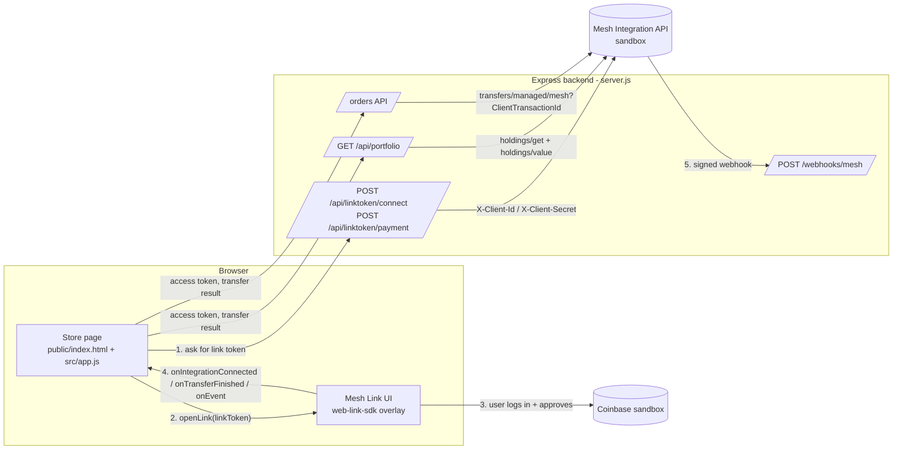

# Mesh Runner Store: pay for shoes with crypto (Mesh sandbox)

A small store app built on Mesh's **sandbox**. It covers all four parts of the take-home:

1. **Connect Coinbase** with Mesh Link.
2. **Pay $50 for "Mesh Runner" shoes** with **50 USDC** from Coinbase to the test wallet `0x0Ff0000f0A0f0000F0F000000000ffFf00f0F0f0` on **Ethereum**, all inside the Link UI.
3. **Read the Coinbase portfolio** with the access token from Link (Mesh holdings API) and show holdings plus totals.
4. **Extras:**
   - An order receipt that is double-checked against Mesh's transfer history.
   - A signed webhook endpoint (HMAC-SHA256 plus `EventId` dedupe).
   - A live "under the hood" panel that shows Link SDK events and webhooks.
   - Returning users can pay without logging in again.

Stack: Node 22+ / Express backend, plain HTML/CSS/JS front end bundled with esbuild, and `@meshconnect/web-link-sdk`.

## Architecture



**Rule of thumb:** the server makes the token, the browser opens Link, the user approves in their own exchange, and the server confirms the result through Mesh (transfer API or webhook). The browser callback alone isn't enough.

## How each flow works

### 1) Connect Coinbase
- `POST /api/linktoken/connect` calls `POST /api/v1/linktoken` with `userId`, `restrictMultipleAccounts: true`, and `integrationId` for Coinbase. In sandbox that's the `sandboxCoinbase` integration, looked up at startup from `GET /api/v1/transfers/managed/integrations`. Passing it skips the exchange picker and opens Coinbase straight away.
- The browser calls `link.openLink(linkToken)`.
- When `onIntegrationConnected` fires, the payload includes `accessToken.accountTokens[0].accessToken` and `brokerType`. The page sends them to `POST /api/session/connection`, and the server keeps them **in memory only** (per browser session cookie).

### 2) Pay $50 in USDC on Ethereum
`POST /api/linktoken/payment` creates an order and requests a Link token with:

```json
{
  "userId": "demo-user-…",
  "restrictMultipleAccounts": true,
  "integrationId": "<sandboxCoinbase id>",
  "transferOptions": {
    "transactionId": "txn_<uuid>",
    "transferType": "payment",
    "isInclusiveFeeEnabled": false,
    "generatePayLink": false,
    "toAddresses": [{
      "networkId": "e3c7fdd8-b1fc-4e51-85ae-bb276e075611",
      "symbol": "USDC",
      "address": "0x0Ff0000f0A0f0000F0F000000000ffFf00f0F0f0",
      "amount": 50
    }]
  }
}
```

- `transferType: "payment"` sets the right wording in Link, and Mesh's docs say `toAddresses[].amount` is **required** for payments. USDC is about $1, so the payment is an exact 50 USDC. `amountInFiat` isn't used because it's meant for onramps and can't be combined with `amount`.
- With `isInclusiveFeeEnabled: false`, fees are added on top, so the merchant gets the full 50 USDC.
- The Ethereum `networkId` was confirmed with `GET /api/v1/transfers/managed/networks` in sandbox.
- `transactionId` ties the Mesh transfer back to our order.
- When `onTransferFinished` fires, the order moves to **Submitted**. That means Coinbase accepted the transfer, **not** that it's confirmed on-chain.
- The receipt then polls `GET /api/orders/:id`. The server checks `GET /api/v1/transfers/managed/mesh?ClientTransactionId=…` and marks the order **Paid** only when Mesh says `succeeded`. A `Succeeded` webhook does the same.

### 3) Portfolio
`GET /api/portfolio` calls `POST /api/v1/holdings/get` and `POST /api/v1/holdings/value` with `{ authToken, type: brokerType }`. It returns positions (symbol, amount, price, value) and totals for crypto, cash, and the whole account. Without a connection it returns a clean `401`. A bad or expired token returns Mesh's error message.

### 4) Webhooks (bonus)
- `POST /webhooks/mesh` uses `express.raw()` so it can compute `base64(HMAC-SHA256(rawBody, MESH_WEBHOOK_SECRET))` and compare it with `X-Mesh-Signature-256` using a timing-safe compare.
- It returns `200` right away and does the work afterwards.
- It dedupes on `EventId`, because retries keep the same `EventId` but get a new `Id`.
- Events show up in the UI panel.
- To turn it on, register `https://<your-public-url>/webhooks/mesh` under Dashboard → Account → API keys → Webhooks and put the secret in `.env`. Mesh sends webhooks from `20.22.113.37`.

## Run it

```bash
cp .env.example .env      # add your sandbox MESH_CLIENT_ID and MESH_API_KEY
npm install
npm start                 # builds public/app.js and serves http://localhost:3000
```

Then, in the Mesh Dashboard under **Account → API keys → Access → Allowed domains**, add the domain you'll open the app on (for example `localhost` or your tunnel domain). Link won't render on domains that aren't on that list.

**Sandbox Coinbase login:** username `Mesh`, password `Pass123`, MFA `123456`. Other users: `MeshUSDC` (USDC only) and `Mesh2` (empty account).

## Security notes
- API keys are read from env vars on the server. They never go to the browser, logs, or git (`.env` is gitignored).
- Access tokens stay in server memory for the demo. In production they'd be encrypted at rest and tied to a real user, or I'd use Mesh Managed Tokens.
- The webhook is verified over raw bytes, uses a constant-time compare, and is idempotent.

## Files
| File | What it is |
| - | - |
| `server.js` | Express backend: link tokens, portfolio, orders, webhook |
| `src/app.js` | Front end logic: Mesh Link callbacks, checkout, portfolio, logs |
| `public/index.html`, `public/styles.css` | Store page |
| `.env.example` | Env vars to set |

## What I'd add for production
- Persist orders and tokens in a database.
- Use real user auth instead of a session cookie.
- Use Mesh Managed Tokens for returning users.
- Add retries and alerts on webhook failures.
- Show the price lock and expiry for non-stablecoin payments (`displayAmountInFiat`).
- Add multi-network checkout (Base and Solana USDC) so users can choose cheaper gas.
